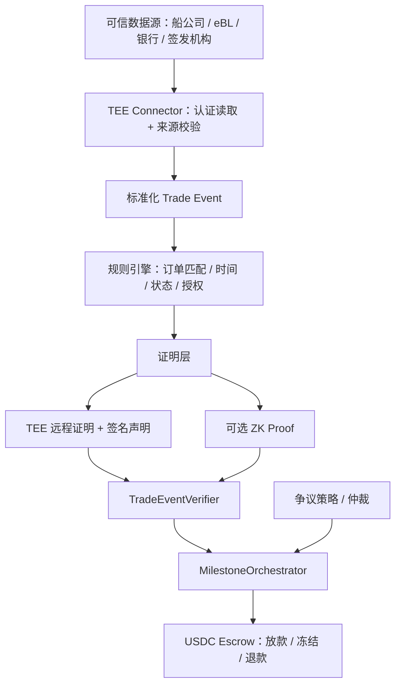

# 国际贸易中的可验证履约事件：TEE / ZKP + Peer 式 Escrow

> **核心判断：** 最值得优先验证的，不是让 AI 自动判定货物质量，而是将国际贸易中已经标准化、由可信第三方产生的数字事件转化为自动放款条件。建议从 **DCSA Track & Trace → TEE 验证 → USDC Escrow** 切入，逐步扩展到电子提单与单据相符付款。

## 一、基本思路

国际贸易存在大量标准化业务记录，但数据分散在船公司、银行、海关、港口和电子单据平台中。Peer（原 ZKP2P）的核心思路是：**对链下支付事实生成可验证证明，再触发链上资金托管合约结算**。将这种模式迁移到国际贸易，可以形成：

1. **事实层**：读取可信数据源的物流、单据、支付和交付状态。
2. **证明层**：使用可信执行环境（TEE）验证来源和业务规则，必要时以零知识证明（ZKP）隐藏敏感字段。
3. **结算层**：由 Peer 式 Escrow 根据经验证的事件释放、冻结或退回 USDC。

必须明确三种不同能力：

- **数据来源认证**：验证记录确实来自船公司、银行或其他获认可的签发机构。
- **TEE 远程证明**：证明特定受保护环境运行了指定验证程序，不自动证明输入内容真实。
- **ZKP**：在不公开完整业务数据的情况下，证明某些预设计算约束成立；ZKP 本身不能证明现实货物或原始 API 记录真实。

因此，第一版不一定要同时引入 TEE 和 ZKP。可以先使用 **可信 API / 签名数据 + TEE 远程证明 + 结构化签名 + 链上验证**，再对隐私与信任最敏感的场景加入 ZK 电路。

## 二、哪些贸易环节最适合单一验证程序？

以下评级属于技术研究判断，**不是**声称这些数据在全球都已开放、统一或可无许可访问。这里的“单一 TEE”指一套可配置、可审计的统一验证程序，而非单个物理服务器。

| 业务环节 | 标准化程度 | 统一 TEE 验证可行性 | 对 Escrow 的价值 | 关键依赖 |
| --- | --- | --- | --- | --- |
| 物流节点（装船、卸船、到港） | 高 | 高 | 很高 | 承运人可信事件 API |
| 电子提单（eBL）签发及状态 | 很高 | 高 | 很高 | eBL 平台、法律上的控制权事件 |
| 商业发票与订单匹配 | 高 | 很高 | 高 | 可信签发者、结构化数据 |
| 银行或支付机构入账确认 | 高 | 高 | 很高 | 银行 / PSP 授权数据接口 |
| 海关放行记录 | 中高 | 中 | 高 | 各法域海关接口及权限 |
| 电子原产地证书 | 中高 | 中高 | 中 | 官方或认可机构签发记录 |
| 标准化质检报告 | 中 | 中 | 中高 | 认可实验室签名及责任机制 |
| IoT 温控与运输记录 | 中 | 中 | 中高 | 可信传感器、设备身份与防篡改 |

优先顺序取决于目标：**物流事件最适合早期商用原型；电子提单的贸易金融价值可能最高；发票与订单匹配最容易做技术演示。**

## 三、三个重点应用场景

### 1. 装船即付款：Shipment-triggered Escrow

**建议优先做 MVP。**

示例：出口商向进口商出售价值 100,000 USDC 的标准化工业零部件。双方约定货款事先锁入合约，确认装船后释放 80%，其余 20% 在后续约定条件满足后释放。**80/20 仅为设计示例，不是行业通用规则。**

流程：

```text
买家将 100,000 USDC 存入 Escrow
           ↓
船公司系统记录“实际装船”事件
           ↓
TEE 从可信承运人接口读取并核验数据
           ↓
核对订单 / 箱号 / 航次 / 事件类型 / 时间
           ↓
生成与订单及里程碑绑定的证明
           ↓
TradeEventVerifier 验证证明及防重放标识
           ↓
争议期届满且无有效异议 → 释放 80,000 USDC
```

在符合合同约定时，可以验证：某个与订单绑定的集装箱或运单，在指定期限内出现可信数据源记录的实际装船事件。可使用 DCSA Track & Trace 的事件模型与承运人 API。

**关键边界：** “船公司记录已装船”不等于“箱内货物符合质量要求”。验证器必须核实数据源、记录与订单之间的可信绑定，并处理事件修改、撤回、延迟或冲突。

### 2. 电子提单触发付款：eBL Escrow

高价值方向是将**电子提单签发、状态与控制权转移**纳入付款条件，使部分跟单结算自动化。

可验证条件包括：

- 电子提单由合同认可的承运人或平台签发；
- 与订单约定的港口、货物描述、装运时间等字段相符；
- 满足“已装船”等所需运输状态；
- 当合同要求时，相关电子提单控制权已完成有效转移；
- 提单未被撤销、作废或处于不符合结算条件的状态。

这与传统信用证的“审单而非直接验货”思路相近，但 **Escrow 不是信用证的完整替代品**：它默认不提供银行信用背书、融资、成熟的国际争议制度或法律执行网络。

尤其需要注意：**eBL 不能简化为一个 PDF 哈希。** 可转让电子记录涉及唯一控制、权利转移、平台规则以及适用法域的法律效力。需要从认可的平台取得可验证的状态与控制权事件。

### 3. 单据相符付款：Documentary Escrow

更容易建立早期技术原型：验证电子发票、装箱单、订单和运输单据之间的标准化字段一致性。

例如验证：

- 发票金额及币种符合合同；
- 货物数量与订单允许的偏差范围一致；
- 运输单据的目的港、装运日期符合约定；
- 卖方身份与可信签发者记录一致；
- 不同单据之间的引用关系一致。

TEE 运行确定性的审单规则；ZKP 可以用于证明金额在约定区间、主体及数量匹配，而不暴露完整合同和单据。

但如果所有文件仅由卖家自行上传、没有可信签发者或原始系统校验，那么该系统只能证明**文件内部一致**，不能证明交易真实。

## 四、组合为多里程碑托管协议

不同交易可以在同一资金托管框架下组合多个经过认证的事件。以下金额分配是说明性参数：

| 里程碑 | 可验证条件 | 示例放款比例 |
| --- | --- | ---: |
| 订单生效 | 双方确认合同及资金已锁定 | 20% |
| 实际装船 | 承运人可信装船事件 | 50% |
| 目的港卸货 | 可信卸货事件 | 20% |
| 最终确认 | 收货确认或合同约定争议期届满 | 10% |

合约必须独立处理：

- 证明已提交但尚未验证；
- 证明已通过但仍在争议期；
- 部分里程碑放款；
- 外部事件后续更正或撤销；
- 争议冻结、仲裁、退款与超时处理；
- 资金不足、重复执行、失效证明和权限变更。

Incoterms 定义交货、风险和费用分担等规则，**并不直接设定付款时间**。任何按 FOB、CIF 等术语定义的付款触发器，仍需在具体合同中单独约定。

## 五、建议的统一 TEE + Escrow 技术架构



一份简化的证明输出可以设计为：

```solidity
struct TradeEventProof {
    bytes32 orderCommitment;
    bytes32 milestoneId;
    bytes32 trustedSourceId;
    bytes32 sourceRecordCommitment;
    bytes32 eventType;
    bytes32 policyHash;
    bytes32 verifierVersion;
    uint256 expiry;
    bytes32 nullifier;
}
```

这只是示意数据结构，实际合约还需要链 ID、合约域隔离、签名者授权、数据签发时间、撤销策略、验证器密钥轮换等保护。

链上可以检查的约束：

1. 来源在该订单的认可数据源集合内；
2. 订单、货物/集装箱和事件存在受信任的绑定；
3. 事件是实际发生状态而不是计划状态；
4. 事件时间满足合同约束；
5. 证明绑定到正确的合约、链、订单和里程碑；
6. 证明未过期、未撤销，且结算授权未被重复使用。

**安全重点：** TEE 处理过 API 响应，不代表 API 响应没有被伪造。TLS 终端认证、数据源签名、会话安全和输入来源证明必须纳入威胁模型。ZKP 也不能自动弥补错误的原始数据。

## 六、Peer.xyz 的哪些部分值得参考？

参考 [Peer / ZKP2P 开源合约](https://github.com/zkp2p/zkp2p-contracts) 中的模块化思想，尤其是**资金托管与证明验证分离**。

| Peer 式组件 / 设计模式 | Fideight 可以建立的对应组件 | 主要作用 |
| --- | --- | --- |
| Escrow / Vault | `TradeEscrow` | 保管 USDC 与分期资金 |
| Orchestrator | `MilestoneOrchestrator` | 生命周期及结算状态机 |
| Payment Verifier | `TradeEventVerifier` | 验证可信贸易事件与证明 |
| 多方证明验证 | 多签发者 / 多验货方门槛 | 减少单一证明主体风险 |
| Nullifier Registry | 结算授权防重放 | 防止同一授权重复放款 |
| Dispute Policy | `DisputePolicy` | 争议期、冻结及退款 |
| Stake Vault / Whitelist | 验货机构准入及可选保证金 | 增加问责能力 |

**不能直接照搬：** Peer 的核心业务是支付事实的证明和 P2P 兑换，其时间尺度、退款逻辑、保证金责任与国际贸易并不相同。贸易 Escrow 需要新增分期放款、可信货物/单据绑定、长周期争议与法律责任安排。开源代码许可也不等于修改后的系统获得安全保证。

## 七、商业上能产生什么效果？

**对卖方：** 买家预先锁定货款，卖方在达到约定的客观事件后可以自动收款，减少纯信用账期的不确定性。

**对买方：** 不必在货物尚无可验证进展时将全部款项直接交给卖家，可以依约分阶段付款。

**对双方：** 把部分人工审单、反复确认和付款指令变成可复核的程序化流程，降低协调成本，也可能缩短结算等待时间。

但它**不会天然提供**银行融资、信用创造、货物质量担保、全套跨境合规或争议执行机制。银行 API、船公司平台、eBL 法律框架及数据接入费用可能成为真实的成本瓶颈。跨境 USDC 收付款还需根据各法域具体评估外汇、支付、反洗钱、税务和贸易合规问题。

## 八、开发与研究优先级

### P0：DCSA Track & Trace → TEE Attestation → USDC Escrow

最推荐的最小原型：限定**一个承运人、一个贸易线路、一个标准化物流事件、一条付款规则**。

先验证四个事实：

1. 能否持续、合法地获取足够可信的事件数据？
2. 如何证明 API 事件属于这笔订单而非另一笔订单？
3. 该事件对买卖双方是否足以构成一个有商业意义的付款条件？
4. 外部事件出现错误或回滚时，合约如何保护资金？

### P1：eBL → 自动化跟单结算

研究有法律意义的 eBL 平台事件、控制权转移和相应法域的电子可转让记录制度。商业价值更高，但第三方集成与法律门槛也更高。

### P2：Invoice + Packing List → 隐私单据匹配

可快速做 ZK 技术演示；但要从“内部数据一致”提升到“可信履约证明”，仍需可信签发者及原始数据来源。

### 后续能力

- 多签发机构 / 多来源交叉核验；
- 保险、质检及电子原产地证书；
- 争议、质押和可归责的责任机制；
- AI 眼镜采集缺少官方数字记录的现场证据。

## 九、最重要的产品定位

Fideight 与其从“AI 智能眼镜验货平台”切入，不如考虑更清晰的底层定位：

> **Verifiable Trade Event Protocol（可验证贸易履约事件协议）：将可信第三方产生的标准化贸易事件转换成可验证的付款条件。**

向上连接物流、eBL、银行和电子单据平台，向下连接 Peer 式的可编程资金托管。AI 眼镜则服务于没有权威数字记录的非标准化现场事件。

**首要研究题目：DCSA Track & Trace 2.2 → 可信数据源验证 / TEE → Peer-style USDC Escrow。**

## 参考资料

- [Peer / ZKP2P 开源合约](https://github.com/zkp2p/zkp2p-contracts)
- [DCSA Track & Trace](https://dcsa.org/standards/track-and-trace)
- [DCSA Implementation Guides](https://reference.dcsa.org/content/standards/guidelines/implementation-guides/implementing-track-and-trace)
- [DCSA Electronic Bill of Lading](https://dcsa.org/standards/bill-of-lading)
- [UNCITRAL MLETR：电子可转让记录示范法](https://uncitral.un.org/en/texts/ecommerce/modellaw/electronic_transferable_records)

---

*说明：本文是基于公开技术标准与协议设计思路提出的研究框架，不是已完成的系统安全审计、法律意见或第三方数据接入可用性承诺。文中所有金额、里程碑比例均为示例。*
